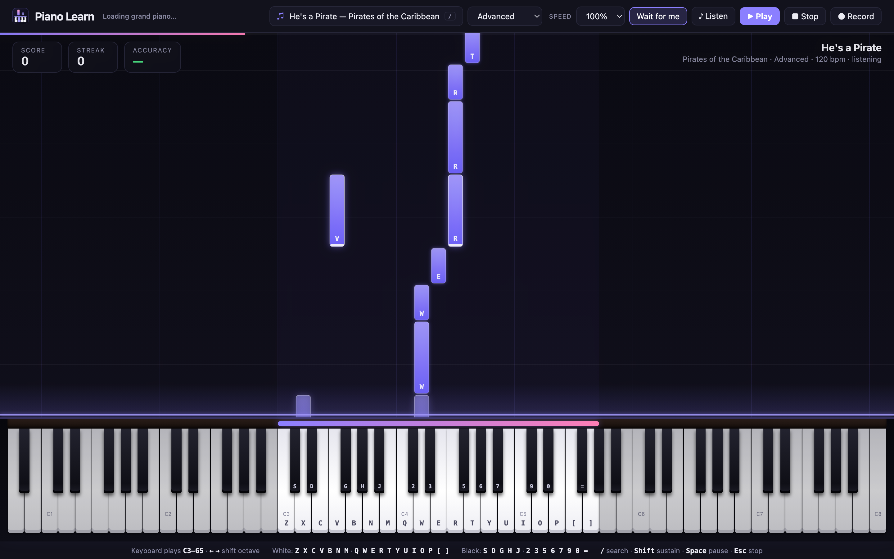
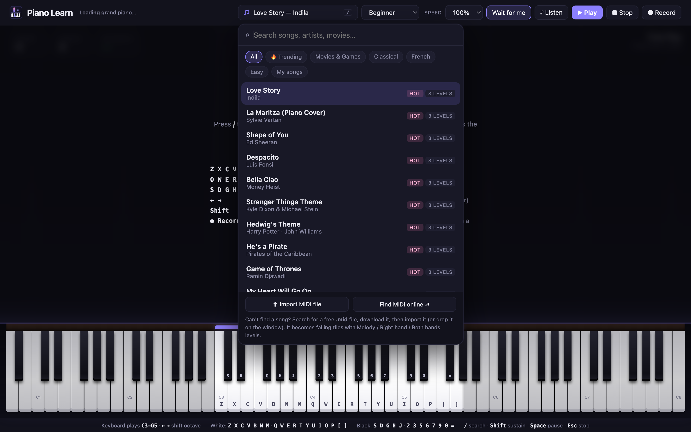

<div align="center">


# Piano Learn

### 🎉 A fun project: turn your laptop keyboard into a piano

**Falling tiles, a real grand piano sound, and 26 songs from beginner to advanced. Built for fun while learning to play.**

[](https://jai0812.github.io/piano-learn/)
&nbsp;

&nbsp;




</div>

---

## ✨ Features

| | |
|---|---|
| 🎹 **Full 88-key piano** | A0 to C8, drawn like a real keyboard. Your laptop keys play a 32-key window you slide with **← →**. |
| 🎼 **Real grand piano sound** | Recorded Yamaha C5 samples (Salamander Grand Piano) with velocity-sensitive tone, sustain pedal and room reverb. |
| 🟪 **Falling tiles** | Synthesia-style tiles fall onto the key you need to press. Each tile shows the letter to type. |
| 💥 **Expression** | **Stressed notes** (bright edge) ring out louder and **holds / pauses** (◠) stretch and breathe — just like a real performance. |
| 🐢 **Learn at your pace** | *Wait for me* mode pauses the song until you hit the right note. Speed 50 % → 125 %. |
| ♪ **Listen first** | Hear any song played for you before you try it. |
| 🔍 **Song library & search** | 26 built-in songs across Trending, Movies & Games, Classical, French and Easy. Press **/** to search. |
| ⬆️ **Import any MIDI** | Drop a `.mid` file onto the window and it becomes tiles with *Melody*, *Right hand* and *Both hands* levels. |
| ● **Record yourself** | Play along with a YouTube video, save it, and practise your own recording with tiles. |
| ⭐ **Scores & stars** | Score, streak, accuracy and a 3-star rating with tips on what to try next. |

## 🚀 How to use

**Online:** open **https://jai0812.github.io/piano-learn/** — that's it.

**Offline / locally:**

```bash
git clone https://github.com/jai0812/piano-learn.git
open piano-learn/index.html
```

> The grand piano samples stream from the web the first time. Without internet the app still works with a simpler built-in sound.

1. Press **/** (or click the song button) and pick a song.
2. Choose **Beginner**, **Intermediate** or **Advanced**.
3. Press **♪ Listen** to hear it, then **▶ Play**.
4. Hit each key when its tile touches the glowing line.

### ⌨️ Keyboard map

```
 Black keys:   S D   G H J   2 3   5 6 7   9 0   =
 White keys:  Z X C V B N M  Q W E R T Y U  I O P [ ]
               C D E F G A B  C D E F G A B  C D E F G
              └─ lower octave ┘└─ upper octave ┘└ top ┘
```

| Key | Action |
|---|---|
| **← / →** | Slide your keyboard window down / up an octave (the purple bar shows where you are) |
| **Shift** | Sustain pedal |
| **Space** | Pause / resume |
| **/** | Search songs |
| **Esc** | Stop |
| 🖱️ Mouse | Click any of the 88 keys |

### 🔗 Shareable links

| Link | Opens |
|---|---|
| [`?song=bella`](https://jai0812.github.io/piano-learn/?song=bella) | Bella Ciao, ready to play |
| [`?song=hedwig&level=advanced&demo`](https://jai0812.github.io/piano-learn/?song=hedwig&level=advanced&demo) | Hedwig's Theme, playing in Listen mode |
| [`?search=movie`](https://jai0812.github.io/piano-learn/?search=movie) | The library with a search filled in |

## 🎵 Songs



| 🔥 Trending | 🎬 Movies & Games | 🎻 Classical | 🌱 Easy |
|---|---|---|---|
| Love Story — Indila | Hedwig's Theme | Für Elise | Happy Birthday |
| La Maritza (Piano Cover) — Sylvie Vartan | He's a Pirate | Moonlight Sonata | Jingle Bells |
| Shape of You — Ed Sheeran | Game of Thrones | Rondo alla Turca | Twinkle Twinkle |
| Despacito — Luis Fonsi | My Heart Will Go On | Canon in D | Ode to Joy |
| Bella Ciao — Money Heist | Mission: Impossible | Spring — Vivaldi | Minuet in G |
| Stranger Things Theme | The Pink Panther | Swan Lake | |
| | Super Mario Bros. | Hall of the Mountain King | |
| | Tetris (Korobeiniki) | | |

Every song has three levels: **Beginner** (melody only, slower), **Intermediate** (both hands) and **Advanced** (full arrangement, full tempo).

### Want a song that isn't here?

1. Search for it in the library — if it's missing, click **Find MIDI online ↗**.
2. Download a free `.mid` file for the song.
3. Click **⬆ Import MIDI file** or just drop it on the window. It's saved in your browser.

## 🧩 Add a song in code

Songs live in `index.html` as simple lists of `[notes, beats, flags]`:

```js
const MY_SONG = [
  ['C3+E4', 1, '>'],  // chord (left hand C3 + melody E4), 1 beat, stressed
  ['G4', 0.5],        // eighth note
  ['A4', 0.5],
  [null, 1],          // rest
  ['G4', 2, '^'],     // held note with a breath after it
];
// then add it to BUILTIN_SONGS:
{ title: 'My Song', artist: 'Me', tags: ['easy'], levels: autoLevels(100, MY_SONG) },
```

Flags: `>` stressed · `^` hold / pause · `p` soft · `f` strong. `autoLevels` builds Beginner / Intermediate / Advanced for you.

## 🛠️ How it works

- **One file, no build step** — plain HTML, CSS and JavaScript in `index.html`.
- **Sound** — Web Audio API plays the nearest recorded sample, pitch-shifted, through a velocity filter, compressor and convolution reverb.
- **Tiles** — drawn on a `<canvas>` every frame, lined up with the real key positions.
- **MIDI import** — a small built-in Standard MIDI File parser (tempo map, running status, drums skipped).
- **Storage** — your recordings and imported songs are kept in your browser's `localStorage`.

## 🙏 Credits

- Piano samples: [Salamander Grand Piano](https://archive.org/details/SalamanderGrandPianoV3) by Alexander Holm, licensed [CC BY 3.0](https://creativecommons.org/licenses/by/3.0/), served via [Tone.js](https://github.com/Tonejs/audio).
- La Maritza melody based on the transcription at [KalimbaTabs.net](https://www.kalimbatabs.net/kalimba-tabs-tutorials/la-maritza-by-sylvie-vartan-easy/).
- Song titles belong to their composers and publishers. Built-in songs are short, simplified practice arrangements written for learning — not full transcriptions.

## 📄 License

[MIT](LICENSE) — the code is free to use, change and share.
